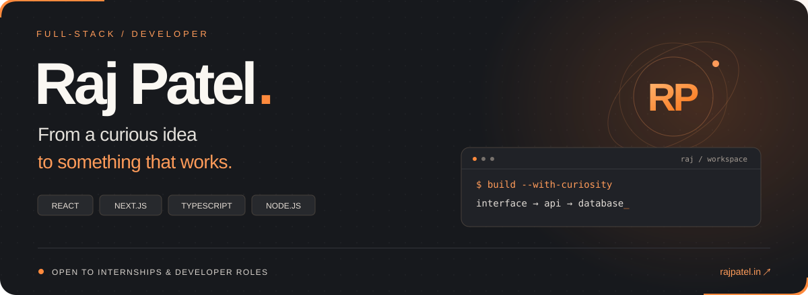

  <a href="https://www.rajpatel.in/"><b>Portfolio ↗</b></a> &nbsp;·&nbsp;
  <a href="https://www.linkedin.com/in/raj-patel-cse"><b>LinkedIn</b></a>

### A student today. A builder along the way.

I'm **Raj**, a B.Tech **Computer Science & Cyber Security** student at **Pranveer Singh Institute of Technology**, graduating in **2027**. I build web applications and enjoy understanding the whole journey: the interface, the API, and the data behind it.

Currently building **PrepPilot**, exploring real-time communication, and sharpening my **DSA problem-solving**. Open to **full-stack internships and entry-level developer roles**.

---

### 01 / Selected work

<table>
<tr>
<td width="50%" valign="top">
<h3>PrepPilot</h3>

<b>A little structure for a big goal.</b>

An interview-preparation workspace for turning goals and available study time into a plan you can review, accept, and follow.

Study scheduling · searchable practice resources · progress tracking

<code>Next.js</code> <code>TypeScript</code> <code>MongoDB</code> <code>Better Auth</code>

<a href="https://prep-pilot-theta-tan.vercel.app/"><b>Explore live ↗</b></a> &nbsp; / &nbsp; <a href="https://github.com/rajpatel110/prep-pilot">Source</a>

Study features require an account.
</td>
<td width="50%" valign="top">
<h3>DevLink</h3>

<b>Find your people. Keep the conversation going.</b>

A full-stack developer networking application for discovering developers, managing connection requests, and messaging accepted connections.

Developer discovery · connection requests · saved conversations

<code>React</code> <code>Redux Toolkit</code> <code>Express</code> <code>MongoDB</code>

<a href="https://dev-link-five-tau.vercel.app/"><b>Explore live ↗</b></a> &nbsp; / &nbsp; <a href="https://github.com/rajpatel110/DevLink">Source</a>

Sign-in required.
</td>
</tr>
</table>

**Also exploring**

- **Vidloom** — browser-based video and data communication using React, TypeScript, WebRTC, and a Node.js WebSocket signaling server.
- **EEG Seizure Prediction** — an academic offline baseline using CHB-MIT EEG recordings, MNE, and Logistic Regression. Ongoing work on evaluation and false positives.

[More about the projects →](https://www.rajpatel.in/#work)

### 02 / My toolkit

| Layer | What I work with |
| :--- | :--- |
| **Interfaces** | React · Next.js · TypeScript · Tailwind CSS · Redux Toolkit · Vite |
| **APIs & data** | Node.js · Express · MongoDB · Mongoose · REST APIs |
| **Auth & validation** | Better Auth · JWT · Zod |
| **Workflow & delivery** | Git · GitHub Actions · Node.js tests · ESLint · Prettier · Vercel |
| **Real-time** | WebRTC · WebSocket · STUN |

### 03 / What keeps me curious

- Turning complicated workflows into clear, usable interfaces.
- Understanding authentication, persistence, and the decisions behind an API.
- Building real-time experiences and getting better at solving problems.

---

<b>Have something worth building?</b> I'm looking for a team where I can contribute, learn, and keep improving.  <a href="https://www.rajpatel.in/#contact">Let's talk ↗</a> &nbsp;·&nbsp; <a href="https://www.rajpatel.in/">rajpatel.in</a>

### 04 / Contribution snake

A little momentum, one contribution at a time.

<picture>
  <source media="(prefers-color-scheme: dark)" srcset="https://raw.githubusercontent.com/rajpatel110/rajpatel110/main/assets/snake-dark.svg" />
  <source media="(prefers-color-scheme: light)" srcset="https://raw.githubusercontent.com/rajpatel110/rajpatel110/main/assets/snake.svg" />
  
</picture>

Refreshed daily with GitHub Actions.
